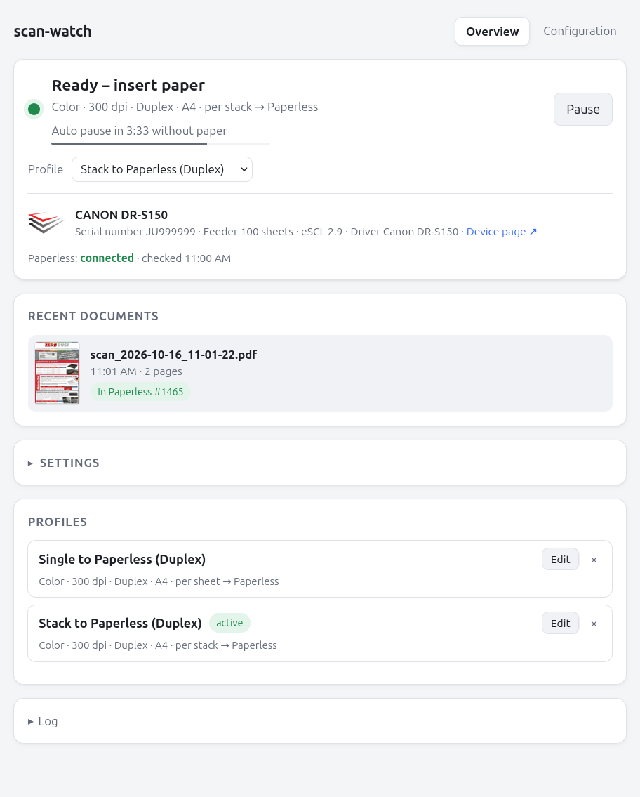
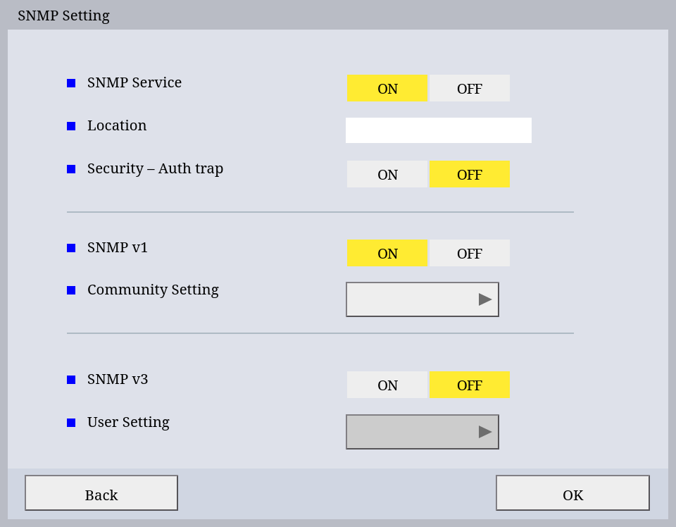
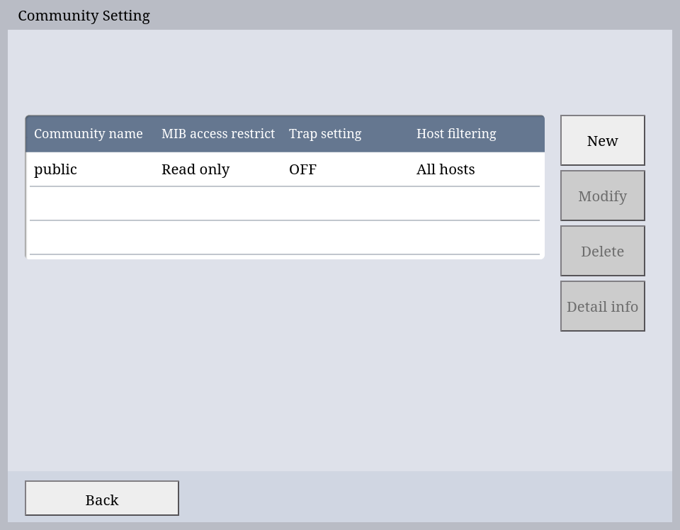

# scan-watch

Scans automatically as soon as paper is placed in the feeder of a network document
scanner and stores each stack (or each sheet) as one PDF in a folder and/or uploads it to
[Paperless-ngx](https://docs.paperless-ngx.com/). Built for the Canon DR-S150, but any
scanner speaking eSCL (AirScan / Mopria) with ADF paper detection should work.

No vendor software and no button presses on the scanner are needed: scan-watch
polls the scanner's eSCL status and starts a job when the feeder reports
`ScannerAdfLoaded`.

It runs either in a terminal with an interactive settings menu or headless, e.g.
in Docker, configured through environment variables, with an optional web
interface for status, recent documents and settings.



## Why this app?

Canon's CaptureOnTouch does not exist for Linux and after ditching Windows I was
unsuccessfully looking for a convenient solution to connect my DR-S150 to paperless.

## Features

**Scanning without lifting a finger**

- Put paper in, walk away: the scan starts by itself, no buttons, no vendor software, no
  driver on any computer.
- Color or grayscale, 100–300 dpi, simplex or duplex, A4, A5, Letter or Legal.
- Blank pages vanish: the empty backs of duplex scans are dropped, while a page with
  nothing but a page number or a signature is kept. Dust, bleed-through and punch
  holes don't count as content.
- One PDF per stack, or one per sheet: drop a pile of letters in and get a separate
  document for each.
- Profiles per scanner, e.g. "stack to Paperless" and "receipts, gray, one per sheet,
  tagged": switch between them with one click.

**Made for Paperless-ngx**

- Uploads with tags (created in Paperless when missing), follows the processing and
  links straight to the new document.
- Self-signed certificate (e.g. a Synology's)? Compare the fingerprint once and pin it
  with one click, like SSH does with host keys.
- Never loses a scan: if Paperless is down, the PDF goes to the folder; if that fails
  too, the web page keeps it for download. Paperless is retried with every new stack.

**A web interface that tells you what is going on**

- Live status, page by page, with previews of the last documents. Works on the phone
  next to the scanner, in light and dark mode.
- Recognizes the scanner and shows its model, serial number, picture and a link to
  its own web page.
- Pause, or let it pause by itself after a while without paper (with a countdown), so
  the scanner can go to standby.
- Speaks up before things go wrong: output folder or settings file not writable,
  Paperless not reachable, or another program (a second scan-watch?) using the scanner.
- English and German, following the browser; adding a language is one `.po` file.

**Easy to run**

- Docker image with a read-only file system, no capabilities, health check and log
  rotation.
- Just as well without Docker: `scan-watch` in a terminal starts with an interactive
  settings menu, `-y` starts right away, and most settings are also command line
  arguments (`--help`; the Paperless token deliberately not). Without a terminal (systemd) the menu is skipped; `--web` adds the web
  interface.
- Settings in `.env` are fixed; everything else can be changed on the page, with an
  optional password.
- Python standard library plus Pillow and img2pdf, nothing else: no framework, no
  database, no CDN, works offline in the LAN.

## Docker

```
cp .env.example .env      # scanner address, Paperless URL and token, password
mkdir -p scans config     # or SCANS_DIR / CONFIG_DIR; writable for PUID:PGID
docker compose up -d --build
docker compose logs -f
```

`.env` holds the values, `compose.yml` lists which of them are used: the Docker
part (host folders, user, port, `TZ`) and the few scan-watch settings that
belong to the installation (scanner address, Paperless URL and token, web
password, optionally auto pause and certificate pin). Nothing else from `.env`
reaches the container, and the paths inside it are fixed in the Dockerfile.

The web interface is at `http://<host>:8080` (or `WEB_PORT`). PDFs land in
`./scans` (or `SCANS_DIR`); settings and profiles are kept in `./config` (or
`CONFIG_DIR`). Both folders must exist and be writable for `PUID:PGID`; Docker
does not create them, so they cannot end up owned by root. `TZ` matters for the
file names, which use local time. `docker compose down` lets a stack that is
currently being scanned finish first.

The scan-watch settings from `.env` are fixed and read-only in the web
interface. Without `SCAN_WATCH_HOST`, the web interface asks for the scanner
address on the configuration page. Scan settings, target and tags are chosen in
the web interface.

The container runs with a read-only file system (writes go to `/config`,
`/scans` and a tmpfs `/tmp`), without capabilities and with
`no-new-privileges`; logs are rotated at 10 MB. Only outgoing connections are
needed (HTTP to the scanner, HTTP(S) to Paperless), so the default bridge
network is fine.

## Without Docker

Requires Python 3.9+, [Pillow](https://pypi.org/project/pillow/) and
[img2pdf](https://pypi.org/project/img2pdf/).

```
pipx install .            # or: pip install --user .
scan-watch                # interactive settings menu, then wait for paper
scan-watch -y             # start immediately with the last used settings
scan-watch --color gray --dpi 200 --no-duplex -y
scan-watch --split sheet -y   # every sheet of the stack becomes its own document
python -m scan_watch      # straight from the source tree
scan-watch -y --web 8080  # with web interface
```

Example: the settings menu, then a duplex sheet scanned and handed to Paperless:

```console
# scan-watch
=== Scan settings ===
   1) Color mode               Color
   2) Resolution               300 dpi
   3) Sides                    Duplex (both sides)
   4) Paper size               A4
   5) Remove blank pages       yes
   6) Blank page threshold     1.0 % (densest tile)
   7) Split                    one document per sheet
   8) Target                   Paperless
   9) Output folder            ./scans
  10) Paperless URL            http://paperless
  11) Paperless token          set
  12) Paperless tags           –
  13) File name prefix         scan
  14) Scanner                  192.168.1.222
  15) Auto pause               after 15 min without paper
  16) Wake-up detection        off

Number to change, Enter = start, q = quit:
Quit with Ctrl+C.

Paperless: connection to http://paperless ok.
Scanner 192.168.1.222, target: Paperless
Ready. Insert paper and it is scanned automatically.
Driver: Canon DR-S150
Scanner detected: CANON DR-S150 (serial number JU999999)
Paper detected – scan starts in 2 s …
  Page 1 (front): 100.00 % content
  Page 2 (back): 100.00 % content
Handed to Paperless: scan_2026-10-16_11-01-49.pdf (2 pages)
Ready for the next stack.
```

Without a terminal (systemd, Docker) the menu is skipped automatically. Stop
with Ctrl+C or SIGTERM.

While watching, scan-watch asks the scanner for its feeder state every second,
which keeps it from going to standby. Pause it with the button in the web
interface or with SIGUSR1 (`docker kill -s USR1 scan-watch`,
`systemctl kill -s USR1 scan-watch`); SIGUSR1 toggles. A stack being scanned is
finished first. The pause is not kept across restarts. After `auto_pause` minutes
(default 30) of waiting for paper it pauses by itself, except while paper from a
failed scan is still in the feeder; the web page shows a countdown.

### Wake-up detection (Canon DR-S150, experimental)

A paused scan-watch does not notice paper: asking the scanner would wake it.
With the **Canon DR-S150 (firmware 1.23)** an automatic pause can end by itself
when paper is inserted. Paper wakes the scanner up, and that can be seen over
SNMP without waking it: in standby its process `panel_service` uses about twice
as much CPU time as while awake. scan-watch asks every 2 seconds and resumes as
soon as the scanner is awake again; the stack is then scanned as usual.

To use it, switch on SNMP v1 in the scanner's web interface (read only) and set
its community, e.g. `SCAN_WATCH_SNMP_COMMUNITY=public` or on the configuration
page.




It is only used after an automatic pause, not after pausing by hand. Waking
the scanner on its display also ends the pause, the next one follows after
`auto_pause` minutes. This depends entirely on how this scanner and firmware
behave: after a firmware update it may stop working (the log says so), with
other scanners it is not available. Then resume by hand as before.

## Web interface

Started with `--web [ADDRESS:]PORT` or `SCAN_WATCH_WEB` (`0.0.0.0:8080` in the
container). The page shows the scanner state live (ready, scanning page n,
feeder blocked, unreachable, paused), the scanner model with serial number and a
link to its own web page (read from eSCL ScannerCapabilities), the last 30
documents with preview, a link to the PDF and their Paperless status, the scan
settings (including Paperless tags) and a log. Paperless connection and scanner
settings are on a separate configuration page (`#config`). It works on a phone,
so settings can be changed right at the scanner; changes made during a scan
apply from the next stack on.

Set `SCAN_WATCH_WEB_PASSWORD` to require a password (HTTP basic auth, any user
name); without it everyone who can reach the port can change the settings. Use
a reverse proxy for HTTPS when the page is reachable beyond the home network.

Everything can be changed in the browser except what is given as environment
variable or argument: that is shown read-only ("fixed"), since it would win
again at the next start anyway. This includes output directory, Paperless URL
and token: whoever can reach the page could otherwise send scans and the token
elsewhere, so set them in `.env` to keep them out of reach (the Docker image
fixes the output directory anyway). A token entered on the page is stored in
the settings file and never sent back to the browser. A self-signed Paperless
certificate can be pinned on the page after comparing its fingerprint.

`/healthz` answers without password and is used by the Docker health check.

## Profiles

Profiles switch several scan settings at once, e.g. "Stack" (one PDF per stack)
and "Single sheets" (one PDF per sheet, gray, 200 dpi, tag "Receipt"). In the
web interface, "Save as profile" next to "Apply" in the custom settings stores
color, resolution, duplex, paper size, split, blank page handling, target,
prefix and Paperless tags under a name. The profile is chosen in the status
section; the list in the settings only edits (values, name) and deletes
profiles. Editing the profile in use applies the changes right away. Profiles
belong to the detected scanner (by serial number, else by address) and are kept
in the settings file. Settings fixed by environment variables or arguments are
not changed by a profile, and the profile editor shows them read-only.

Profiles exist only in the web interface; the terminal menu and the command
line arguments do not use them. Start with `--web` to have them while running in
a terminal.

## Settings

Settings are taken, in increasing priority, from the defaults, the settings file,
`SCAN_WATCH_<NAME>` environment variables and command line arguments
(`--help` lists them). The resulting settings are written back to the settings
file: `~/.config/scan-watch.json`, or `$SCAN_WATCH_CONFIG` (`/config/settings.json`
in the container). The menu marks values that come from the environment, since
those win again at the next start.

Environment variables and arguments are not defaults: they fix a setting. The
web interface shows it read-only and profiles leave it alone, so
`SCAN_WATCH_COLOR=gray` scans every profile in gray. With the web interface,
set only the installation in `.env` (scanner, Paperless, password) and choose
the scan settings in profiles; the other variables are meant for running without
it (terminal, systemd).

| Variable                          | Default   | Values                                                                                       |
| --------------------------------- | --------- | -------------------------------------------------------------------------------------------- |
| `SCAN_WATCH_HOST`                 | –         | scanner IP or host name; without it, set in the web interface                                |
| `SCAN_WATCH_TARGET`               | `folder`  | `folder`, `paperless`, `both`                                                                |
| `SCAN_WATCH_OUT`                  | `~/Scans` | output directory (`/scans` in the container)                                                 |
| `SCAN_WATCH_PAPERLESS_URL`        | –         | e.g. `https://paperless.lan`                                                                 |
| `SCAN_WATCH_PAPERLESS_PUBLIC_URL` | –         | address for links in the browser, if it differs (e.g. `http://paperless:8000` inside Docker) |
| `SCAN_WATCH_PAPERLESS_TOKEN`      | –         | API token, see below                                                                         |
| `SCAN_WATCH_PAPERLESS_TLS_PIN`    | –         | certificate fingerprint, see below                                                           |
| `SCAN_WATCH_COLOR`                | `color`   | `color`, `gray`                                                                              |
| `SCAN_WATCH_DPI`                  | `300`     | `100`, `150`, `200`, `240`, `300`                                                            |
| `SCAN_WATCH_DUPLEX`               | `true`    | `true`, `false`                                                                              |
| `SCAN_WATCH_PAPER`                | `a4`      | `a4`, `a5`, `letter`, `legal`                                                                |
| `SCAN_WATCH_SKIP_BLANK`           | `true`    | `true`, `false`                                                                              |
| `SCAN_WATCH_BLANK_THRESHOLD`      | `1.0`     | percent, see blank page detection                                                            |
| `SCAN_WATCH_SPLIT`                | `stack`   | `stack`, `sheet`                                                                             |
| `SCAN_WATCH_PREFIX`               | `scan`    | file name prefix                                                                             |
| `SCAN_WATCH_AUTO_PAUSE`           | `30`      | minutes without paper until it pauses itself, `0` = never                                    |
| `SCAN_WATCH_SNMP_COMMUNITY`       | –         | SNMP v1 community for the wake-up detection (Canon DR-S150 only)                             |

Files are named `<prefix>_YYYY-MM-DD_HH-MM-SS.pdf`. When a stack yields several
documents, they get a running number: `<prefix>_YYYY-MM-DD_HH-MM-SS_001.pdf`, …

## One document per sheet

With _split_ set to `sheet`, a stack of single-sheet documents (letters, invoices,
receipts) is scanned in one go and each sheet ends up as a separate PDF. In duplex
mode front and back of a sheet stay together; blank sides are dropped as usual
and a sheet that is blank on both sides produces no document at all.

## Paperless-ngx

Set the target to `paperless` or `both`, and give the Paperless URL and an API
token (Paperless: profile menu → _API Auth Token_). The token belongs into `.env`
(`SCAN_WATCH_PAPERLESS_TOKEN`); it is never accepted as a command line argument
and never copied from the environment into the settings file. A token entered in
the menu is stored in the settings file, which is kept at mode 600.

Optional tags are given by name; missing tags are created. After the upload
scan-watch follows the Paperless task in the background and reports whether the
document was consumed (or rejected, e.g. as a duplicate).

For HTTPS with a self-signed certificate (such as the Synology default one) exactly
one certificate can be pinned by its SHA-256 fingerprint:

- **Terminal:** the fingerprint is shown once with the question whether to trust
  it, like SSH does for host keys. After a certificate change, enter the URL in
  the menu again.
- **Headless:** the log prints the fingerprint. After comparing it with the one
  shown in the browser (lock icon → certificate), put it into `.env` as
  `SCAN_WATCH_PAPERLESS_TLS_PIN` and restart. After a certificate change, empty
  the variable to get the new fingerprint.

If Paperless cannot be reached, the PDF is stored in the output directory
instead, so no scan is lost. When Paperless answers `400 Bad Request`, add the
address used here to `PAPERLESS_URL` or `PAPERLESS_ALLOWED_HOSTS`.

## Blank page detection

Each page (without a 5 % border) is split into tiles of about 8 mm. A page counts
as blank when even its densest tile has less ink than the threshold. Text
clusters into dense tiles while dust and bleed-through do not, so a page holding
only a page number or a signature is kept. If blank backs slip through, raise
the threshold; if sparse pages get dropped, lower it. The score of every page is
logged while scanning.

## Language

Texts are written in English and translated with gettext catalogs in
`scan_watch/locale/` (German so far). The web interface follows the browser
language (`Accept-Language`) for everything it shows, including the log. The log
itself (systemd, Docker, redirected output) is always English, so it reads the
same everywhere; only an interactive terminal session shows the menu and
messages in the language of `LANG`.

Adding a language: copy `scan_watch/locale/messages.pot` to `<lang>.po`, set
`"Language: <lang>\n"` in its header, run `python3 tools/update_po.py` and fill
in the `msgstr` entries with any .po editor (Poedit, Weblate, …). After changing
texts in the code, run `tools/update_po.py` again: it adds new texts with an
empty translation and drops unused ones. The tests fail while a text is
untranslated, a placeholder differs or a catalog is out of date.

## Development

```
make            # lists the targets: test, check, po, run, up, down, logs, pause, …
make check      # unit tests + translation catalogs, as in CI
```

User-visible changes go under `[Unreleased]` in [CHANGELOG.md](CHANGELOG.md).
Development happens in a separate repository; each release is published to
[GitHub](https://github.com/dartcafe/scan-watch) as a single commit.

The scan loop (`scan_watch/core.py`) does not print; it reports through an event
callback and exposes its state, so other front ends can be put on top of it.

### Scanner drivers

Every eSCL scanner works with the generic driver (`scan_watch/drivers/escl.py`).
A scanner that needs more, such as the DR-S150's wake-up detection, gets its own
driver: a module in `scan_watch/drivers/` with a class derived from `Escl` that
lists the models it is for and overrides only what differs. scan-watch finds the
module by itself and picks the driver by the model the scanner reports (shown on
the web page), nothing needs to be registered. `canon_dr_s150.py` is the example;
the methods a driver can override are documented in `escl.py`.

## License

MIT, see [LICENSE](LICENSE).
